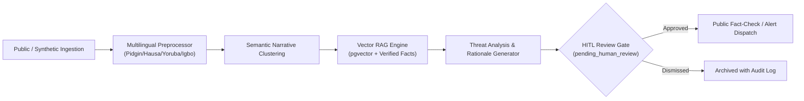

# Sentinel-AI

> **Real-Time Electoral Misinformation & Narrative Monitoring Engine**  
> Developed for the **#AI4Elections Hackathon** (Rise Networks in collaboration with INEC & Partners)  
> **Track:** Track 1 — AI and Trustworthy Electoral Information  
> **Team Name:** Sentinel AI Labs

---

## 👥 Team Members
- **Victor Okpe** (Team Lead, Backend & Systems Engineer) — `okpevictor84@gmail.com`
- **Jezreal Momoh** (Software / AI Engineer) — `Jezreelmomoh1234@gmail.com`
- **Joy Umofia** (Product Designer) — `joyumofia@gmail.com`

---

## 📌 Problem Statement
Viral political misinformation, coordinated rumor campaigns, and fabricated election results spread across social platforms and messaging apps at velocities far outpacing manual debunking. By the time a single claim is refuted, the underlying narrative has already influenced public perception and eroded confidence in electoral integrity.

## 💡 Solution Overview
**Sentinel-AI** provides an end-to-end, automated electoral narrative intelligence platform:
1. **Early Narrative Clustering:** Groups incoming social posts and reports into semantic narrative clusters to detect emerging disinformation trends early.
2. **Vector RAG Verification:** Cross-references claims against an authoritative database of verified electoral facts (INEC Regulations, Electoral Act 2022) using `pgvector` cosine similarity search.
3. **Multilingual Ingestion:** Normalizes and detects Nigerian languages (Nigerian Pidgin, Hausa, Yoruba, Igbo) alongside Standard English.
4. **Strict Human-in-the-Loop (HITL):** Enforces a `pending_human_review` state for threat alerts, displaying clear rationale, source provenance, and confidence metrics so election observers and accredited fact-checkers make the final determination.
5. **NDPA 2023 Compliance:** Adheres strictly to the Nigeria Data Protection Act 2023 by processing public and synthetic signals without scraping private individual records or probing electoral databases.

---

## 🛠️ Architecture & Tech Stack

- **Backend:** Python 3.11+, FastAPI (asynchronous), Pydantic v2
- **Database & Vector Store:** PostgreSQL 16 with `pgvector` extension
- **ORM:** SQLAlchemy 2.0 (asyncio + asyncpg)
- **Containerization:** Docker & Docker Compose
- **NLP / Embedding:** Semantic vector search (384-dimensional embeddings), Nigerian lexicon normalizer



---

## 🚀 Getting Started

### Prerequisites
- Docker & Docker Compose
- Python 3.11+ (if running locally without Docker)
- Git

### 1. Clone & Configure Environment
```bash
git clone https://github.com/Victorbjay/sentinel-ai.git
cd sentinel-ai
cp .env.example .env
```

### 2. Start with Docker Compose
```bash
docker compose up -d --build
```
The services will be available at:
- **API Documentation (Swagger UI):** [http://localhost:8000/docs](http://localhost:8000/docs)
- **Healthcheck:** [http://localhost:8000/api/v1/health](http://localhost:8000/api/v1/health)
- **PostgreSQL + pgvector:** `localhost:5432`

### 3. Local Development (Without Docker)
```bash
python -m venv venv
# On Windows:
.\venv\Scripts\activate
# On Linux/macOS:
source venv/bin/activate

pip install -r requirements.txt
uvicorn app.main:app --reload --port 8000
```

---

## 🛡️ Responsible AI & Ethical Guardrails
- **No Autonomous Result Declaration:** The system is explicitly bounded from proclaiming electoral outcomes or making legal fraud determinations.
- **Explainability:** Every generated flag includes a transparent rationale explaining which INEC guidelines or verified facts contradict the claim.
- **Auditability:** Complete timestamped audit trail of all reviewer decisions and confidence scores.

---

## 📜 License
This project is licensed under the Apache 2.0 License for the #AI4Elections Hackathon.
