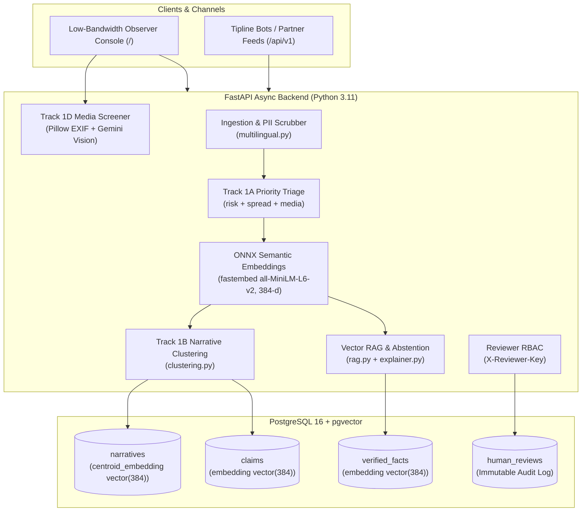

# System Architecture: Sentinel-AI

## 1. High-Level Architecture

## 2. Data Model & Storage Boundaries
- **`claims`:** Stores redacted text, detected language (`en`, `pcm`, `ha`, `yo`, `ig`), `risk_score`, `spread_score`, `synthetic_media_attached`, `triage_priority`, 384-dim `embedding`, and `status` (always initialized as `pending_human_review`).
- **`narratives`:** Stores `NarrativeCluster` centroids (`centroid_embedding`), `volume_count`, `velocity_score`, and escalated `threat_level`.
- **`verified_facts`:** Stores authoritative INEC Electoral Act 2022 rules and `#AI4Elections` multilingual voter FAQs with 384-dim `embedding`.
- **`human_reviews`:** Immutable audit trail of accredited reviewer decisions protected by `X-Reviewer-Key`.

## 3. Security, Privacy & Responsible AI Boundaries
- **NDPA 2023:** URLs, emails, `@handles`, phone numbers, and 11-digit IDs/NINs are scrubbed before database persistence; reporter tags containing emails/digits are hashed via `blake2b`.
- **Human-in-the-Loop:** No automated result declaration, no automated public labeling, and confidence-based abstention (`confidence < 0.48`) defers uncertain claims to human observers.
- **No Live System Access:** Strictly isolated from live INEC BVAS/IReV/voter register infrastructure.
